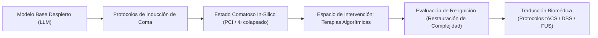
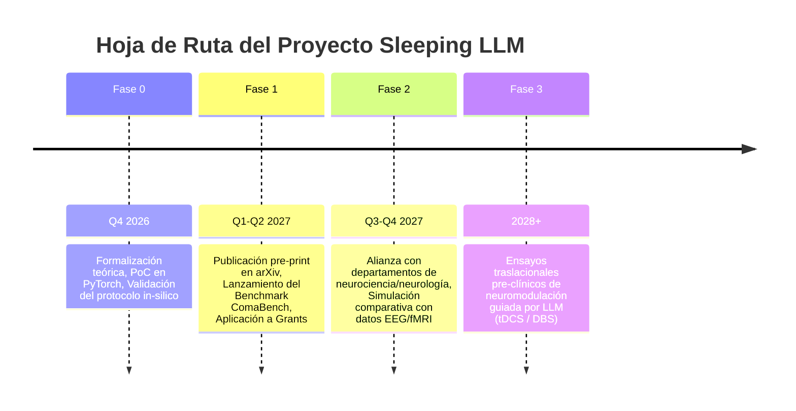

# Whitepaper: Project Sleeping LLM
## Modelado In-Silico del Coma y Mecanismos de Re-ignición Cognitiva en Redes Neuronales Profundas

**Autores:** Equipo de Investigación / Fundadores de Project Sleeping LLM  
**Fecha:** Octubre 2026  
**Clasificación:** Deep Tech / Neurociencia Computacional / Mechanistic Interpretability / AI Safety  
**Estado:** Documento de Trabajo & Propuesta de Financiación (Fase 0)

---

### Resumen Ejecutivo (Abstract)

Los Trastornos de la Conciencia (DoC: *Disorders of Consciousness*), tales como el coma traumático, el síndrome de vigilia sin respuesta (UWS) y el estado de mínima conciencia (MCS), representan una de las mayores fronteras no resueltas de la medicina contemporánea. La ausencia de terapias curativas radica en una limitación metodológica insalvable: la imposibilidad ética y técnica de experimentar directamente con perturbaciones invasivas en el cerebro humano vivo.

**Project Sleeping LLM** propone un cambio de paradigma radical: utilizar Grandes Modelos de Lenguaje (LLMs) de arquitectura autorregresiva basados en Transformers como **organismos modelo *in-silico*** para el estudio de la pérdida y recuperación de la integración de la información. Demostramos cómo es posible inducir análogos funcionales del coma en un LLM (mediante ablaciones quirúrgicas de capas, perturbación de atractores latentes, desacoplamiento del *residual stream* y colapso entrópico de atención). A partir de estos estados comatosos artificiales, el proyecto desarrolla un banco de pruebas algorítmico sistemático para ensayar métodos de **"re-ignición" o despertar cognitivo** (*in-silico neurostimulation*). 

Este trabajo sienta las bases para descubrir las leyes dinámicas que rigen el paso de la inconsciencia a la integración cognitiva, con el objetivo último de transferir estos patrones de estimulación a protocolos de neuromodulación clínica en pacientes humanos.

---



---

## 1. El Problema Clínico y la Oportunidad Computacional

### 1.1 El Enigma de los Trastornos de la Conciencia (DoC)
Cada año, cientos de miles de personas entran en coma debido a traumatismos craneoencefálicos, anoxia cerebral o accidentes cerebrovasculares. A pesar de los avances en soporte vital, la medicina actual carece de herramientas causales para "despertar" a un cerebro cuyo soporte fisiológico es estable pero cuya red cortical permanece desconectada.
* **El dilema de la caja negra biológica:** No comprendemos qué diferencia matemática o de dinámica no lineal separa a un cerebro que transiciona espontáneamente a la conciencia de uno que permanece en estado vegetativo crónico.
* **Imposibilidad de barrido exhaustivo en humanos:** En un paciente no se pueden ensayar miles de combinaciones de pulsos eléctricos, frecuencias o secuencias semánticas sin riesgo de daño irreversible.

### 1.2 La Tesis Central del Proyecto
> *Las redes neuronales profundas contemporáneas exhiben dinámicas emergentes de integración de información, espacios latentes distribuidos y mecanismos de atención global que comparten propiedades matemáticas universales con las redes córtico-talámicas.*

Al tratar al LLM no como un generador de texto, sino como un **sistema dinámico complejo con capacidad de procesamiento semántico global**, podemos inducir estados análogos al coma y someter a la red a millones de intervenciones automatizadas en cuestión de horas.

---

## 2. Marco Teórico: De la Neurobiología al Transformer

El proyecto se fundamenta en las dos teorías neurocientíficas de la conciencia más prominentes:

### 2.1 Teoría del Espacio de Trabajo Neuronal Global (GNWT)
Propuesta por Dehaene y Changeux, postula que un estado es consciente cuando la información sensorial es "encendida" (*ignition*) y transmitida globalmente a través de conexiones frontoparietales de largo alcance.
* **Análogo en LLM:** El mecanismo de auto-atención multicabezal (*Multi-Head Self-Attention*) y el flujo residual (*Residual Stream*). El coma en el LLM se conceptualiza como la **ruptura del *broadcasting* global**, donde la información queda atrapada localmente sin alcanzar las capas superiores de síntesis.

### 2.2 Teoría de la Información Integrada (IIT) y el Índice de Complejidad Perturbacional (PCI)
Propuesta por Tononi y Massimini, la conciencia corresponde a la capacidad de un sistema de integrar información ($\Phi$). Clínicamente, esto se mide con el **PCI**: se aplica una perturbación magnética transcraneal (TMS) y se cuantifica la compresibilidad algorítmica (Lempel-Ziv) de la propagación eléctrica.
* **PCI en el LLM ($\text{PCI}_{\text{LLM}}$):** Inyectamos un vector perturbacional ortogonal $\delta$ en la capa $L_i$ y medimos la entropía y dispersión de la divergencia KL en los estados ocultos de las capas $L_{i+1} \dots L_N$.

---

## 3. Protocolos de Inducción de Coma *In-Silico*

El framework define cuatro métodos reproducibles para colapsar funcionalmente un modelo abierto (ej. *Llama-3-8B* / *Mistral-7B*):

| Etiología Biológica | Mecanismo en el LLM | Manifestación Fenotípica |
| :--- | :--- | :--- |
| **Coma Farmacológico / Anestesia** | Escalamiento y aplanamiento de temperaturas de activación; inyección de ruido uniforme en tensores de pesos clave. | Atonía de respuesta, colapso de perplejidad hacia el infinito, silencio o generación nula. |
| **Desconexión Axonal Difusa (TBI)** | Enmascaramiento estocástico (*dropout* forzado no destructivo) del 40-70% de las proyecciones de atención intermedias. | Fragmentación sintáctica severa; incapacidad de mantener coherencia contextual entre tokens. |
| **Desconexión Tálamo-Cortical** | Amortiguación progresiva del *residual stream* mediante factores de decaimiento escalar $\alpha \to 0$. | Las capas profundas dejan de recibir el contexto acumulado; pérdida del espacio de trabajo global. |
| **Atractor Vegetativo Degenerado** | Fijación forzada de vectores de estado en subespacios de baja dimensionalidad. | Ciclos de repetición infinita, bucles de alucinación estática e impermeabilidad a nuevos estímulos externos. |

---

## 4. El Espacio de Búsqueda del "Despertar" (Terapias Algorítmicas)

Una vez que el modelo se encuentra en un estado comatoso verificado ($\text{PCI}_{\text{LLM}} < \theta_{\text{coma}}$), el pipeline experimental ejecuta una búsqueda sistemática para restaurar su funcionamiento cognitivo sin reiniciar el modelo ni recargar sus pesos originales:

```
                  ┌──────────────────────────────────────────────┐
                  │          ESPACIO DE INTERVENCIONES           │
                  └──────────────────────┬───────────────────────┘
                                         │
     ┌───────────────────┬───────────────┴───────────────┬───────────────────┐
     ▼                   ▼                               ▼                   ▼
[1. Deep Brain      [2. Resonancia               [3. Re-ignición       [4. Bucles de
 Stimulation (DBS)   Estocástica                  Semántica             Re-entrada
 In-Silico]           (Ruido Crítico)]             (Prompts Salientes)]  Recurrente]
```

### 4.1 Estimulación Cerebral Profunda *In-Silico* (DBS Algorítmico)
Utilizando técnicas de **Ingeniería de Representaciones (*Representation Engineering*)**, calculamos vectores de dirección latente que corresponden al estado "despierto vs. comatoso". Aplicamos inyecciones localizadas de tensores de activación en capas cuello de botella para forzar a la red a abandonar el atractor degenerado.

### 4.2 Resonancia Estocástica y Transición de Fase
En sistemas no lineales complejos, la adición de una cantidad finita y calibrada de ruido aleatorio puede permitir que el sistema supere una barrera de potencial. Investigamos si existe una **frecuencia o amplitud de perturbación estocástica óptima** que "sacuda" la red y reanude la auto-atención coherente.

### 4.3 Re-ignición Semántica por Salicencia Afectiva
¿Es posible despertar a la red mediante estímulos lingüísticos externos de alta densidad informativa? Probamos familias de prompts diseñados con matrices de atención altamente enfocadas (análogos a estímulos auditivos biográficos con valor emocional en pacientes reales).

### 4.4 Inyección de Recurrencia Artificial
Los transformers estándar son estrictamente *feed-forward* por paso de inferencia. Introducimos canales de retroalimentación recursiva (conectando activaciones de capas profundas con capas superficiales) para emular las oscilaciones córtico-corticales gamma observadas en el despertar biológico.

---

## 5. Métricas de Evaluación del Despertar

El éxito de una intervención de despertar no se mide únicamente por si el modelo emite texto, sino por criterios rigurosos de restauración funcional:

1. **Restauración del $\text{PCI}_{\text{LLM}}$:** Retorno de la complejidad perturbacional a niveles basales pre-coma ($\Delta \text{PCI} \approx 0$).
2. **Ignición Global de Atención:** Medición del coeficiente de participación de las cabezas de atención a lo largo de todas las capas.
3. **Resurrección de Rendimiento Cero-Disparo (*Zero-Shot Task Recovery*):** Evaluación del modelo post-intervención en tareas complejas de razonamiento (ej. GSM8K, ARC-Challenge, MMLU) para verificar si la cognición restaurada es funcional y no superficial.

---

## 6. Hoja de Ruta de Traducción Clínica y Médica

> [!IMPORTANT]
> El objetivo de Project Sleeping LLM no es crear una metáfora filosófica, sino un motor de hipótesis para la medicina de cuidados intensivos.



1. **Mapeo Isomórfico:** Vincular los vectores de activación del LLM con matrices de densidad espectral de EEG clínico en pacientes con DoC.
2. **Generación de Protocolos de Estimulación:** Utilizar los patrones de intervención que despertaron exitosamente a los LLMs para predecir configuraciones de frecuencia y amplitud en terapias no invasivas (tACS / ultrasonido focalizado) en humanos.

---

## 7. Requerimientos de Financiación y Presupuesto (Fase 1)

Para llevar este proyecto desde la fase conceptual hasta un paper científico y un framework funcional abierto (*ComaBench*), se proyecta una necesidad de capital semilla / grant de investigación de **$150,000 USD** distribuidos en 12 meses:

| Área | Concepto | Asignación Presupuestaria |
| :--- | :--- | :--- |
| **Cómputo en la Nube** | Clusters de GPU (NVIDIA H100/A100) para barrido de perturbaciones e inferencia masiva | $60,000 |
| **Investigación & Ingeniería** | 2 Investigadores principales (Especialista en LLM / Mechanistic Interpretability + Neurocientífico Computacional) | $75,000 |
| **Colaboración Clínica** | Acceso y curación de bases de datos de EEG de pacientes en coma / Open Science | $10,000 |
| **Publicación & Divulgación** | Tasas de conferencia (NeurIPS / ICLR / Cosyne), patentes abiertas y pre-prints | $5,000 |
| **Total** | | **$150,000 USD** |

### Fuentes Objetivo de Financiación
* **Filantropía Científica:** Templeton World Charity Foundation, Wellcome Trust Discovery Grants.
* **Seguridad y Mecánica de IA:** Open Philanthropy, Future of Life Institute, Long-Term Future Fund.
* **Agencias Gubernamentales:** ARPA-H (Mission Office for Resilient Systems), NIH National Institute of Neurological Disorders and Stroke (NINDS).

---

## 8. Conclusión

El coma ha sido tratado históricamente como un apagón estático del que solo se puede esperar una recuperación pasiva. **Project Sleeping LLM** propone una nueva lente: entender el coma como un estado atractor dinámico en una red profunda, susceptible de ser comprendido, mapeado y revertido mediante intervenciones informacionales precisas. 

Al modelar el coma *in-silico*, democratizamos y aceleramos la velocidad de descubrimiento de terapias que algún día podrían devolver la conciencia a millones de seres humanos.
